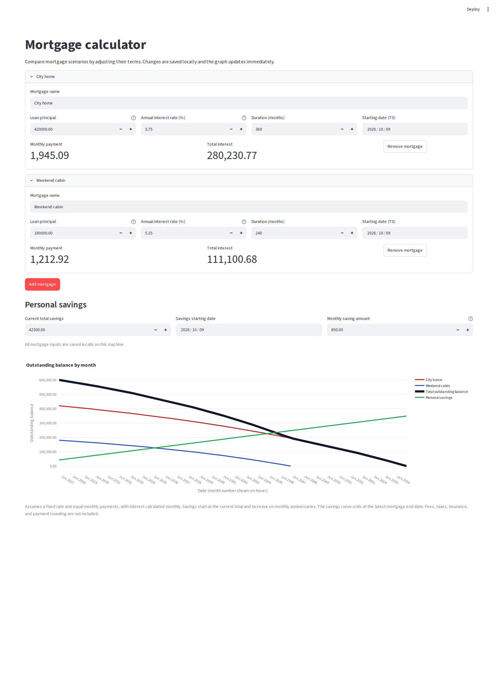

# Mortgage calculator

A small browser-based mortgage calculator with an interactive outstanding
balance graph. Add multiple mortgage scenarios to compare their outstanding
balances in different colors on the same graph. Edit each scenario's name,
principal, annual interest rate, duration, and starting date (T0); changes
immediately recalculate and redraw the graph. Calendar dates appear on the
x-axis, and hovering over an individual mortgage point shows its month number.
A thicker total-balance curve sums all mortgage balances over their combined
scheduled dates.

Add multiple partial repayments, each linked to a mortgage with its own date,
amount, funding source, and schedule adjustment. Choose personal savings or an
external fund. A personal-savings repayment reduces the savings balance on its
entered date and cannot exceed savings available on that date. The amount is
also capped at the target mortgage's remaining balance on the application date.
Repayment entries are saved locally with the mortgage scenarios and restored
on the next app launch.

## Demo

Illustrative sample inputs for two mortgage scenarios and personal savings:



All mortgage scenarios are saved locally in `mortgage_inputs.json` and restored
on the next app launch. This file is shared by app sessions on the machine
running Streamlit. Existing single-mortgage save files are migrated
automatically.

Personal savings are also plotted as a cumulative curve through the latest
mortgage end date. Enter the current savings total and its starting date; the
monthly saving amount is added on each monthly anniversary. Repayment-related
payment reductions are added to that monthly growth from the next affected
installment; when a keep-payment repayment pays a mortgage off early, its freed
monthly payment is added after payoff. If the savings starting date is after
the latest mortgage end date, no savings curve is shown. Savings settings are
saved in the same local file.

## Run

```sh
python -m venv .venv
. .venv/bin/activate
pip install -r requirements.txt
streamlit run app.py
```

## Run with Docker

Compose builds from the GitHub repository, so the Dockerfile must be present
in the remote branch:

```sh
docker compose up --build
```

Open <http://localhost:8501> to use the app. Stop with `Ctrl+C`, or run
`docker compose down`.

## Calculation assumptions

- The annual rate is fixed and nominal; it is divided by 12 to calculate
  monthly interest.
- Payments are equal monthly payments on a fully amortizing loan.
- The schedule and graph show month 0 (the initial principal) and every month
  through the final payment.
- Monthly dates are anniversaries of T0. If a month has fewer days than T0's
  day of the month, its date uses that month's final day.
- A partial repayment is applied after the regular installment on the next
  scheduled payment date on or after its entered date.
- Personal savings-funded repayments are debited on the entered repayment
  date. Savings availability includes monthly contributions made by that date;
  repayments cannot predate the savings starting date or overdraw savings.
- A reduced mortgage installment increases monthly savings growth by the
  installment decrease, starting with the first reduced installment. When a
  keep-payment repayment shortens the term, the mortgage's monthly payment is
  added to savings growth after the mortgage is paid off early.
- For each partial repayment, choose to keep the current monthly payment and
  shorten the term, or keep the original end date and recalculate the monthly
  payment.
- Fees, taxes, insurance, and payment rounding are excluded. Displayed amounts
  use the same currency unit as the entered principal.
